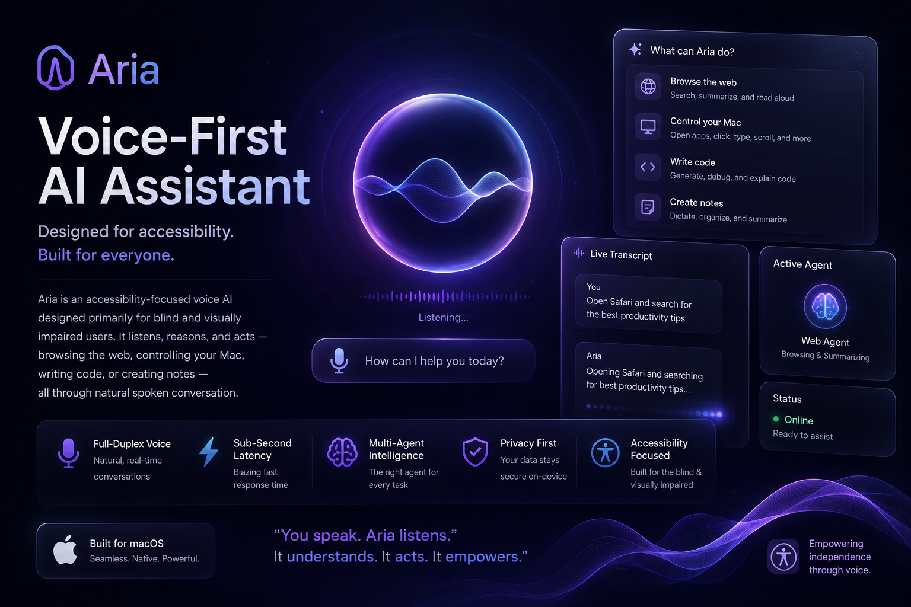
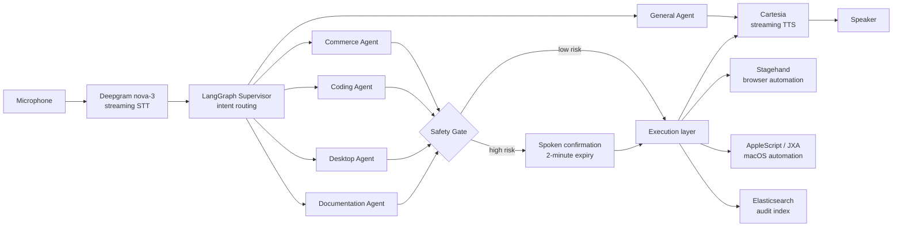
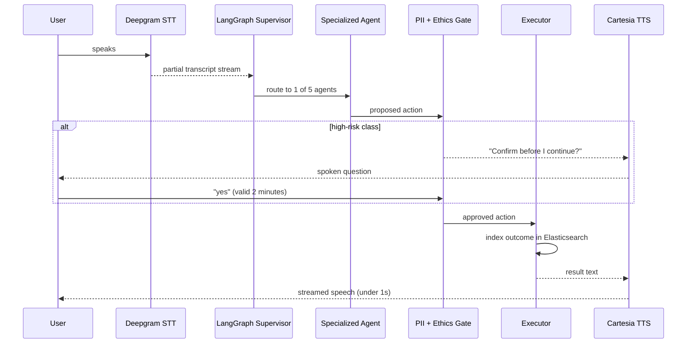

# Aria — Voice-First Agentic Desktop Assistant



> An accessibility-first voice AI built for blind and visually impaired users. You speak; Aria reasons about what you need and acts — browsing the web, controlling your Mac, writing code, or taking notes — in one continuous spoken conversation.

[](https://electronjs.org)
[](https://langchain-ai.github.io/langgraph/)
[](https://deepgram.com)
[](https://cartesia.ai)
[](https://anthropic.com)
[](https://elastic.co)
[](https://vitest.dev)

---

## Highlights

- Orchestrated **5 specialized agents** for shopping, coding, browsing, desktop control, and notes through a **LangGraph supervisor** in a full-duplex Electron voice assistant, combining Deepgram transcription and Cartesia speech streaming for interaction latency under **1 second**.
- Gated **3 high-risk action classes** behind spoken confirmation before execution — destructive shell commands, payments, and sensitive text entry — and scanned for **4 PII types**, including SSNs and card numbers, before the assistant typed into apps.
- Scoped pending approvals to the active session and expired them after **2 minutes**, so a stale "yes" can never execute the wrong action later in a long voice conversation.
- Indexed routing events and **4 confirmation outcomes** (`confirm_required`, `resumed`, `cancelled`, `reask`) in Elasticsearch, exposing the latest **50** records through `/api/audit/:sessionId` for auditability.
- Built **3 runtime surfaces** — Electron desktop app, Next.js web client, and a Node.js Socket.io server — to coordinate real-time voice, agent routing, and local automation.
- Separated **2 automation paths**: Stagehand for browser control, and macOS AppleScript/JXA for desktop control, because browser and desktop automation fail in different ways.
- Covered **4 critical safety areas** with Vitest: the PII scanner, the ethics rules, the confirmation store, and supervisor confirmation routing.

---

## Architecture



## Request lifecycle



---

## The five agents

| Agent | What it does |
|---|---|
| **Commerce** | Browses, searches products, compares prices and ratings, can add to cart and check out |
| **General** | Navigates any website, reads and summarizes articles, answers factual questions |
| **Coding** | Reads, writes and edits files, runs shell commands, debugs errors, searches the codebase |
| **Desktop** | Controls macOS via screenshots plus mouse and keyboard — opens apps, clicks, navigates UIs |
| **Documentation** | Dictates and files notes, including Apple Notes |

## Safety model

| Control | Scope |
|---|---|
| Spoken confirmation gate | Destructive shell commands, payments/checkout, sensitive text entry |
| PII scanner | SSNs, credit card numbers, emails, phone numbers — checked before any typing |
| Approval expiry | Pending approvals scoped to the session, expire after 2 minutes |
| Audit trail | Routing + `confirm_required` / `resumed` / `cancelled` / `reask` indexed in Elasticsearch |

## Tech stack

**Voice** Deepgram nova-3 STT · Cartesia WebSocket TTS
**Agents** LangGraph · LangChain · Anthropic Claude · OpenAI · Ollama
**Automation** Stagehand (web) · AppleScript / JXA (macOS)
**Runtime** Electron · React · Vite · Next.js · Node.js · Express · Socket.io
**Observability** Elasticsearch audit index · Vitest

## Getting started

```bash
git clone https://github.com/Brijesh03032001/Aria.git
cd Aria
npm install
cp .env.example .env     # DEEPGRAM_API_KEY, CARTESIA_API_KEY, ANTHROPIC_API_KEY
npm run dev              # Socket.io server + Electron app
```

```bash
npm run test             # Vitest: PII scanner, ethics rules, confirmation routing
```

---

**Built by [Brijesh Kumar](https://github.com/Brijesh03032001)** · [Portfolio](https://brijeshbuilds.com) · [LinkedIn](https://linkedin.com/in/brijeshkumar03)
